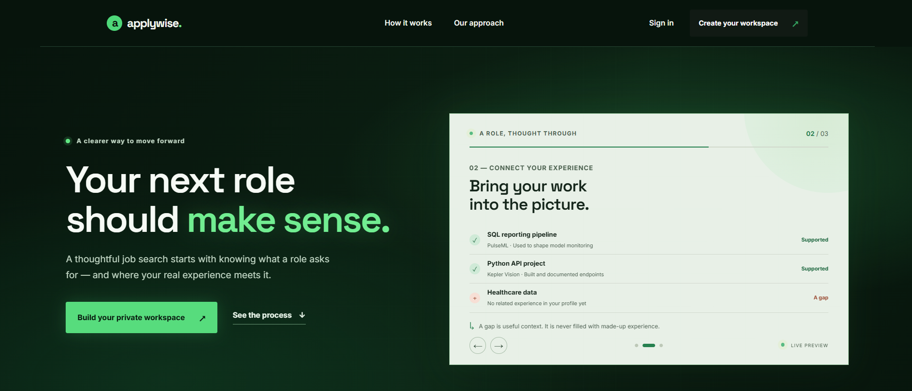
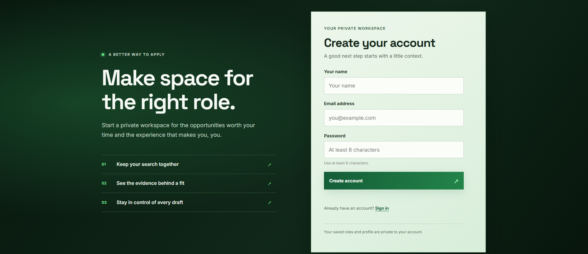
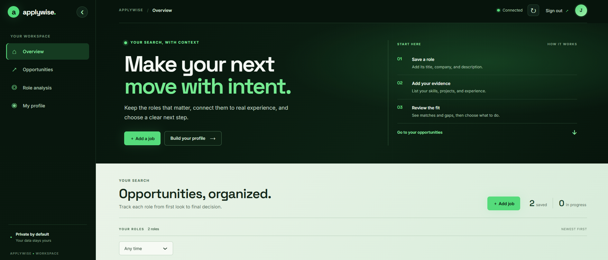
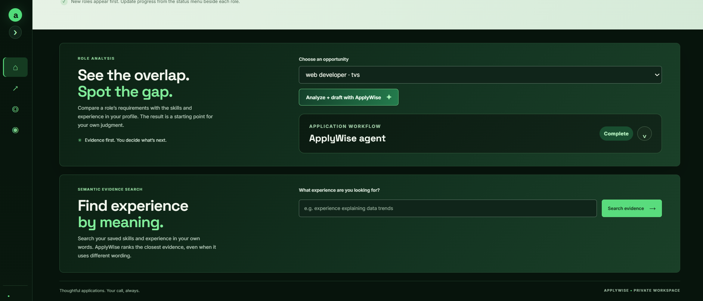
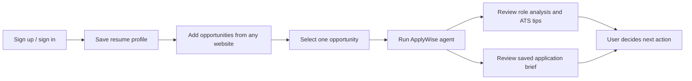
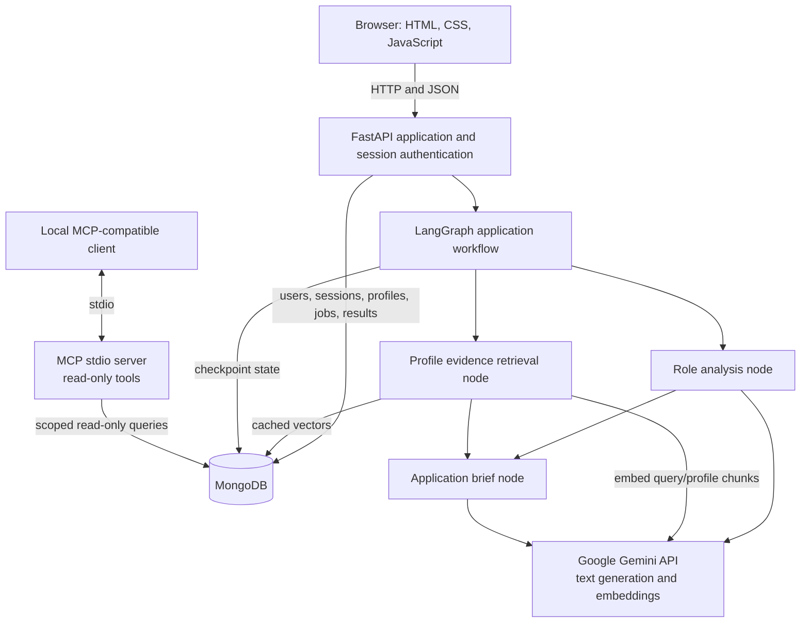
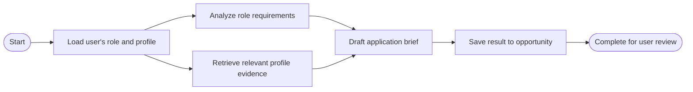

# ApplyWise

> **An agentic AI job-application workspace for people managing many opportunities at once.**

ApplyWise keeps job opportunities, a resume profile, role-fit analysis, and application drafts together. Instead of rereading every job description and manually comparing it with the same resume, a user saves their profile once, adds each opportunity, and asks the ApplyWise agent to analyze that role and prepare a grounded draft. The user reviews and decides what to do; ApplyWise does not submit applications.

**Project status:** local portfolio project. Signup, profile and job tracking, Gemini analysis, semantic evidence retrieval, the LangGraph workflow, and saved application briefs are implemented. Email verification, automated job submission, and a public custom domain are intentionally future work.

## The problem this project addresses

Applying to several AI, machine-learning, and data-science roles means repeating the same work: reading long descriptions, identifying the important requirements, checking each one against a resume, keeping track of gaps, and tailoring application materials. Doing that repeatedly by hand is slow, easy to lose track of, and makes it harder to explain why a role is or is not a fit.

ApplyWise is designed around a reusable profile and many separate opportunities:

1. Save resume skills and experience once.
2. Add roles found on any website, including their descriptions and application links.
3. Run the workflow separately for each role. The agent reads that role’s requirements and retrieves relevant evidence from the saved profile.
4. Review the role analysis and a saved application brief for that opportunity.

This keeps evidence and drafts attached to the right opportunity instead of asking the user to manually repeat the comparison for every application. Jobs are entered by the user; ApplyWise does not scrape job boards.

## What ApplyWise does

| Feature | What it does for the job seeker |
| --- | --- |
| **One reusable resume profile** | Import selectable text from a PDF/DOCX or enter skills and experience once. Review and edit the profile before saving. |
| **A workspace for many roles** | Add a role from any website with its title, company, description, and optional link. Keep opportunities organized by application status and date. |
| **Role-by-role agent workflow** | Analyze each saved role independently, retrieve relevant experience from the profile, and prepare a brief for that specific opportunity. |
| **Semantic evidence search** | Search by meaning, not only exact keywords. A role’s “data pipeline” requirement can surface related saved experience even when the resume uses different wording. |
| **Evidence-led role analysis** | Review requirements marked supported, partial, or gaps, with profile excerpts where available. A deterministic check validates quote presence and fit-score arithmetic. |
| **ATS-style keyword guidance** | See an estimated keyword-alignment score, keywords supported by experience, skills needing proof, and gaps to address honestly. It is not an employer ATS score. |
| **Saved application brief per opportunity** | Review a cover-letter draft, talking points tied to saved evidence, and areas to strengthen. Copy and personalize the draft before using it. |
| **User stays in control** | ApplyWise organizes, analyzes, and drafts. It does not submit applications or invent missing experience. |
| **Account-specific workspace** | Profiles, jobs, analyses, briefs, and cached embeddings are scoped to the signed-in account. |

## Screenshots

### Landing page



### Create-account page



### Workspace overview



### Role analysis and semantic evidence search



> The supplied account screenshot shows **Create your account**. A separate screenshot of the **Sign in** page can be added when available.

## How to use ApplyWise

1. Create an account or sign in. Email verification is currently disabled, so signup should take you directly to the workspace.
2. Open your profile and enter your skills and experience, or import a selectable-text PDF/DOCX resume. Review and save the extracted text. The original uploaded file is not retained.
3. Add a job you found elsewhere: role title, company, job description, and optionally its URL.
4. Select that opportunity and choose **Analyze + draft with ApplyWise**.
5. Review the role requirements, fit estimate, evidence, and ATS tips. Open the application brief to review its cover letter draft, talking points, and areas to strengthen.
6. Personalize any AI output yourself. ApplyWise saves material to the selected opportunity but never submits an application.

Each user’s profile, opportunities, analysis, briefs, agent runs, and embedding cache are associated with that user account. Use fictional profiles and job descriptions for demos. When a user invokes Gemini analysis or drafting, the selected job description and saved profile text are sent to the configured Gemini API. Resume upload by itself only extracts text for the user to review.

## Screens and product flow




## System design



### Agent workflow

The graph loads one user’s selected role and saved profile. Role analysis and evidence retrieval are independent, so they run in parallel. The draft node then uses the role, saved profile, and retrieved snippets to create an application brief. LangGraph checkpoints workflow state in MongoDB so the UI can show progress and recover a failed run.



The central graph wiring is intentionally small:

```python
builder.add_edge(START, "load_context")
builder.add_edge("load_context", "analyze_role")
builder.add_edge("load_context", "find_profile_evidence")
builder.add_edge(
    ["analyze_role", "find_profile_evidence"],
    "draft_application_brief",
)
builder.add_edge("draft_application_brief", "finish")
```

The analysis output is structured and audited before display. The audit verifies whether quoted evidence appears in the saved experience and recalculates fit totals from the match labels:

```python
data = result.model_dump()
return audit_analysis_quality(data, profile_skills, experience_evidence)
```

This is a deterministic citation and arithmetic check. It cannot prove that evidence is semantically relevant, and the fit estimate is not a hiring prediction.

## Technology stack and how each part is used

| Layer | Technology | Role in ApplyWise |
| --- | --- | --- |
| Backend API | Python, FastAPI, Uvicorn | Serves the website, authentication, profile and opportunity APIs, and AI workflow endpoints. |
| Frontend | HTML, CSS, vanilla JavaScript | Marketing, signup/login, dashboard, workflow progress, and result rendering. No React or Streamlit is required for the main product website. |
| Database | MongoDB 8, PyMongo | Stores user accounts, hashed session-token records, profiles, opportunities, analysis results, briefs, cached embeddings, and LangGraph checkpoints. |
| Generative AI | Google Gemini API via `google-genai` | Extracts role requirements, labels profile support, and drafts structured application-brief details. |
| Embeddings | Gemini Embedding API | Converts job/profile text into vectors for semantic evidence retrieval. Vectors are cached in MongoDB and ranked with cosine similarity in Python. |
| Agent orchestration | LangGraph | Represents the workflow as explicit steps, runs independent analysis/retrieval steps in parallel, and checkpoints state in MongoDB. |
| Tool integration | MCP Python SDK | Exposes three local, read-only tools for opportunities, the latest analysis, and local keyword search over profile evidence. |
| Resume extraction | `pypdf`, `python-docx` | Extracts selectable text from PDF and DOCX uploads, up to 5 MB. OCR for scanned PDFs is not included. |
| Local infrastructure | Docker Compose | Runs MongoDB locally. PostgreSQL is available only under the legacy migration profile. |

### What makes the AI workflow agentic here?

The model is not called once to answer a generic prompt. ApplyWise gives the workflow a defined goal and state, runs distinct analysis and retrieval steps, joins their results, saves a brief to the selected opportunity, and reports progress. LangGraph manages this orchestration; Gemini provides generation and embeddings; MCP exposes separate read-only tools to compatible local clients.

The workflow is bounded and user-reviewed. It does not search job boards, log in to employer sites, send applications, or make decisions for the user.

### Why not train or fine-tune a model now?

Fine-tuning is not the right next step for this version. The project does not have a large, carefully labeled, consented dataset of resumes, job requirements, evidence matches, and reviewed outcomes. Training on a small personal dataset would risk overfitting, add cost and maintenance, and make factual grounding harder to guarantee. The current design uses a general Gemini model, structured output, saved profile evidence, semantic retrieval, and deterministic checks.

If the project later collects an appropriate dataset with consent, the next step should be to build an evaluation set and measure specific errors first. Fine-tuning would only be justified if it measurably improves those evaluations over prompting and retrieval.

## Local setup on Windows

### 1. Open the project folder

```powershell
Set-Location 'D:\KEMEE\Projects\ApplyWise'
```

### 2. Create or activate the Python environment

The current project environment is Python 3.14:

```powershell
py -3.14 -m venv .venv314
.\.venv314\Scripts\Activate.ps1
python -m pip install -r requirements.txt
```

If `.venv314` already exists, skip the `venv` creation command.

### 3. Configure the Gemini key

```powershell
notepad .env
```

If `.env` does not exist yet, create it from the template first:

```powershell
Copy-Item .env.example .env
```

Set `GEMINI_API_KEY` in `.env`. Keep the file private; do not commit it or paste its contents into chats. The local MongoDB connection and model settings are also in this file. Email/SMTP settings are not needed because verification email is future work.

### 4. Start MongoDB

Make sure Docker Desktop is running, then start the default database service:

```powershell
docker compose up -d mongo
docker compose ps
```

MongoDB should report a healthy status.

### 5. Run the website and API

```powershell
python -m uvicorn app.api.main:app --reload
```

Open [http://127.0.0.1:8000](http://127.0.0.1:8000). The API reference is available at [http://127.0.0.1:8000/docs](http://127.0.0.1:8000/docs), and [http://127.0.0.1:8000/health](http://127.0.0.1:8000/health) checks the app/database connection.

Stop Uvicorn with **Ctrl+C** in its PowerShell window. Keep Docker Desktop and MongoDB running while using ApplyWise.

## MCP demo

The MCP server is a local stdio process. Set `APPLYWISE_MCP_USER_EMAIL` in `.env` to the account the MCP server is allowed to read. Start the server from the project folder with:

```powershell
python -m app.mcp_server
```

Available read-only tools:

- `list_my_opportunities`: list the configured account’s opportunities.
- `get_my_latest_role_analysis`: retrieve a saved analysis for an opportunity.
- `search_my_profile_evidence`: local keyword-overlap search; it does not call Gemini.

`scripts/mcp_demo.py` demonstrates connecting to the stdio server and calling these tools. Its client launcher currently expects the `.venv314` environment.

## Future development and why it is deferred

| Future item | Why it is not in this local prototype yet | What should come before implementation |
| --- | --- | --- |
| Email verification and password recovery | Signup currently works without SMTP so users can try the product without an email-provider setup. | Choose an email provider, implement expiring one-time codes, resend limits, recovery flows, and security checks. |
| Job application submission | Employer sites have different forms and policies; unattended submission can send inaccurate or unwanted information. | Build explicit per-site integrations, secure consent and review steps, and require the user to approve each final submission. Never store employer passwords. |
| Public `.com` website | The current site is served locally at `127.0.0.1`; no public domain or production service is configured. | Select hosting and a domain, configure HTTPS, production MongoDB, secret management, monitoring, backups, privacy terms, and account protections. |
| Model fine-tuning | No suitable labeled training corpus exists yet, and tuning would add cost without proven quality gains. | Create consented, synthetic or appropriately licensed examples; build evaluation metrics; demonstrate a measured benefit over the current prompt-and-retrieval approach. |
| AI quality evaluation | The current project has deterministic evidence-quote and score-arithmetic checks, but no repeatable benchmark suite. | Compare results on a curated set of fictional profiles and job descriptions, measuring requirement extraction, evidence relevance, unsupported claims, and latency. |
| OCR for scanned resumes | Current PDF import reads selectable text; image-only pages contain no text to extract. | Choose an OCR engine and add clear handling for low-confidence extraction. |

These decisions keep the current project focused on the repeated resume-to-role comparison problem while preserving the user’s control over personal information and application submission.

## Known limitations

- The displayed ATS-style percentage is an estimate from requirement labels, not a score produced by an employer’s ATS.
- Evidence checks confirm exact quote presence and score arithmetic, not semantic correctness or hiring outcomes.
- Gemini output may be incomplete or incorrect. Review all analysis and drafts, and never use a claim that does not match your actual experience.
- Job listings are manually entered. Automated job discovery and employer-site submission are not implemented.
- Email verification, password reset, account recovery, deployment, and public launch are not implemented.

## Project structure

```text
app/
  api/        FastAPI routes and request/response schemas
  db/         MongoDB access and legacy PostgreSQL migration models
  services/   Gemini, LangGraph, analysis quality, and semantic retrieval
  mcp_server.py
scripts/      Migration, database count, and MCP demo scripts
web/          Landing page, authentication, dashboard, CSS, and JavaScript
compose.yaml  MongoDB plus optional legacy PostgreSQL migration service
```

